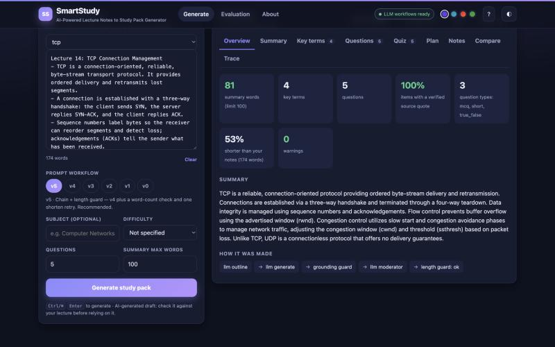

# SmartStudy: AI-Powered Lecture Notes to Study Pack Generator

A prompt-engineering project that converts university lecture notes into a concise summary, key terms with definitions, and practice questions with an answer key. Every term and answer carries a **quote from the notes that code verifies**, so a student can check where it came from.

**SCSE4041 Prompt Engineering · Bennett University · Milestone 2 · Problem Pool C2**

| | |
|---|---|
| Team | IntelliCore (Team ID **PE-B37-17**, batch B37-48) |
| Faculty | Pawan Kumar |
| Model | Gemini 3.1 Flash-Lite via the Gemini API (switchable: Gemini, Anthropic, Ollama) |



## Team
| Name | Enrollment no. | Role |
|---|---|---|
| Darsh Jasoria | S24CSEU0844 | Team leader, experiments and deployment |
| Mahak Soni | S24CSEU2741 | Prompt design and iteration log |
| Pradanya Sharma | S24CSEU1697 | Testing and evaluation |
| Arnav Singh | S24CSEU1770 | Diagrams, documentation and reel |

## How it works
Four prompts and two code checks (final workflow **v5**):

1. **P1 Outline (LLM):** list the topics the notes teach.
2. **P2 Generate (LLM):** summary, key terms and N+2 candidate questions, each with a verbatim quote.
3. **Quote guard (code):** drop any item whose quote is not in the notes.
4. **P3 Moderator (LLM):** an independent call answers every question from the notes only and rejects bad ones.
5. **Keep first N (code):** never pad; warn if fewer questions pass.
6. **Length guard (code + P4):** count summary words; if over the limit, shorten once.

Prompt techniques: role and constraints, strict JSON schema, few-shot with a negative example, source grounding, prompt chaining, over-generate and filter, an escape hatch (`warnings`), rubric-based evaluation. All prompts are plain text in [`prompts/`](prompts/).

## Results (live Gemini runs, 22 Nov 2026, 9 notes, one run per version)
| Version | term_recall | coverage | invented terms | answer_support | constraints met |
|---|---|---|---|---|---|
| v1 zero-shot | 0.358 | 0.649 | 0.091 | 0.725 | 0.0 |
| v2 role + schema + quotes | 0.220 | 0.622 | 0.0 | 0.956 | 1.0 |
| v3 + one example | 0.237 | 0.568 | 0.0 | 0.956 | 1.0 |
| v4 chain | 0.254 | 0.676 | 0.053 | 0.867 | 1.0 |
| v5 chain + length guard | 0.254 | 0.676 | 0.053 | 0.867 | 1.0 |

Test table: **11 of 13 pass**. The two failures are honest findings: a 3-sentence note and casual chat both get 5 questions with no warning. Full details: [`docs/experiment_log.md`](docs/experiment_log.md), [`docs/test_table.md`](docs/test_table.md). The first October experiments used simulated answers and are kept apart in `test-data/replay_simulated_oct28/`; they are not used for any claim.

## Quick start
Python 3.9+ only, nothing to install. Full guide, also written for AI assistants: [`SETUP_FOR_AI.md`](SETUP_FOR_AI.md).

```bash
bash run.sh test      # 22 unit tests
bash run.sh app       # demo mode, no key: replays saved SIMULATED answers for the 9 sample notes, http://localhost:8000
cp .env.example .env  # then add your free Gemini key
bash run.sh live      # web app with the real model
bash run.sh m2tests   # re-run the 13-input test table (needs the key)
```

## Deploy online (Vercel)
Push to GitHub, import the repository on Vercel, and set the environment variables listed in [`SETUP_FOR_AI.md`](SETUP_FOR_AI.md#6-put-it-online-with-vercel-frontend-and-backend-together). The API key lives only in Vercel's settings, never in the repository.

## Repository layout
```
api/index.py        Vercel entry point         code/smartstudy/   backend + static/index.html frontend
vercel.json         Vercel configuration       code/tests/        22 unit tests
prompts/            v1 v2 v3 v4 final          test-data/         notes, gold labels, test inputs, results
docs/               report PDFs, logs, figures CHANGELOG.md       dated changes since Milestone 1
```

## Limitations
Key-term recall is low (3 to 6 terms per note against 10 to 15 in the gold list); the model pads thin or non-lecture input instead of warning; metrics are automatic proxies with no human scoring yet; one run, one model, nine computer-science notes. Output is a revision aid: check it against your lecture. Do not paste personal data; the app stores nothing.

## AI assistance
Drafts of the code, prompts and documents were produced with Claude Code (Claude Sonnet 5.5) in the team leader's session; the team reviewed, ran and is responsible for the work. Member roles are listed in the Team table above.
