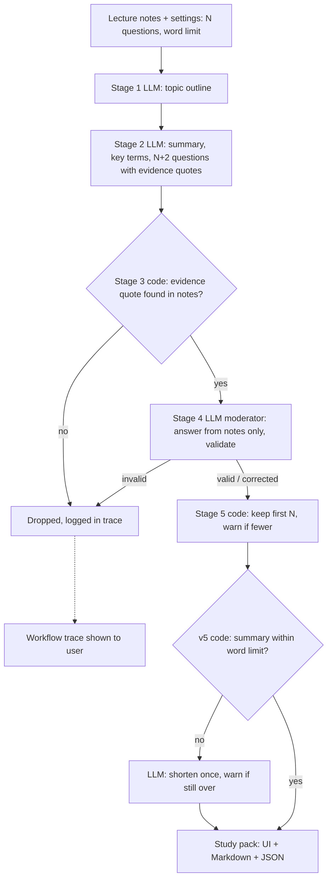
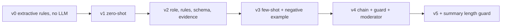
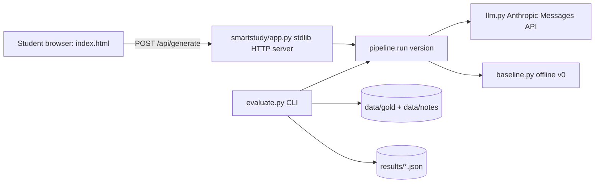

# 1. Prompt / Solution Design and Diagrams (Milestone 2, 2 marks)

## 1.1 Task decomposition
| Step | Sub-task | Done by | Why separate |
|---|---|---|---|
| 1 | Outline the topics in the notes | LLM prompt `v4_outline` | Gives step 2 a coverage checklist, so no topic is skipped |
| 2 | Generate summary, terms, N+2 questions with evidence quotes | LLM prompt `v4_system` | One schema-bound generation |
| 3 | Check each quote exists in the notes | **Code** (`is_grounded`) | Exact string checks are cheaper and more reliable than asking an LLM |
| 4 | Answer each question from the notes only; reject or fix | LLM prompt `v4_verify` | Independent second pass catches wrong or outside-knowledge answers |
| 5 | Keep first N valid questions, warn if fewer | **Code** | Never pad with unverified questions |
| 6 (v5) | Count summary words; if over the limit, one LLM shorten retry; warn if still over | **Code + LLM** | Models cannot count words reliably; code can |
| 7 | Render study pack (Markdown / UI) | **Code** | Deterministic formatting |

## 1.2 Workflow diagram (v4)


## 1.3 Version ladder (what each experiment changes)


## 1.4 Input / output contract
Input: `notes` (text, 40 to 20,000 chars), `n_questions` (default 5), `max_words` (default 100).
Output JSON schema:
```json
{"summary": "string <= max_words",
 "key_terms": [{"term": "", "definition": "", "evidence": "verbatim quote", "grounded": true}],
 "questions": [{"type": "mcq|short|true_false", "question": "", "options": ["..."] , "answer": "", "evidence": "verbatim quote", "grounded": true}],
 "warnings": [], "trace": {"stages": [], "dropped": []}, "errors": []}
```

## 1.5 System / interface diagram


## 1.6 Design decisions
* **Evidence quotes**: forcing a verbatim quote per item turns "is it hallucinated?" into a string-match test.
* **Over-generate and filter** (N+2): filtering would otherwise lower the question count and break the constraint.
* **Escape hatch** (`warnings`): the prompt allows fewer questions when notes are thin, which removes the pressure to invent.
* **Low temperature (0)** for reproducibility; `--runs 3` measures run-to-run stability.
* **Standard library only**: reproducible on any machine with no installs.

## 1.7 Evaluation dashboard (web app, "Evaluation" page)
The dashboard reads the project files through small read-only endpoints, so it always shows what is in the repository:

| View | Data source (endpoint) | What it shows |
|---|---|---|
| Overview | `/api/results` (latest `results/<version>_*.json`) | KPI cards, metric table with the best value per column, All / Short / Long switch, bars, workflow cost, CSV export |
| By note | `/api/matrix` | Heat map of every note against every workflow for a chosen metric, plus a detail table for one workflow |
| Test set | `/api/testset` (`data/notes`, `data/gold`) | Notes, word counts, gold terms, must-cover ideas, out-of-scope terms |
| Prompt versions | `/api/prompts` (`prompts/`) | Every prompt file for v1 to v5 and the version history |
| Experiment log, Project docs | `/api/doc?name=...` (whitelist of project documents) | Hypotheses, findings, pilot run, design, rubric, checklist, contribution log, video script |
| Metrics guide | static | Definition of each metric and method notes |

Safety: the server binds to 127.0.0.1, serves only whitelisted documents, validates and clamps inputs (notes 40 to 20,000 characters, 1 to 15 questions, 30 to 300 summary words), and stores nothing.

